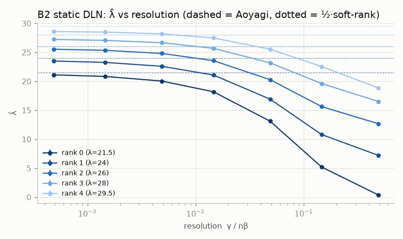
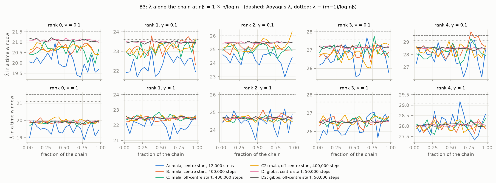
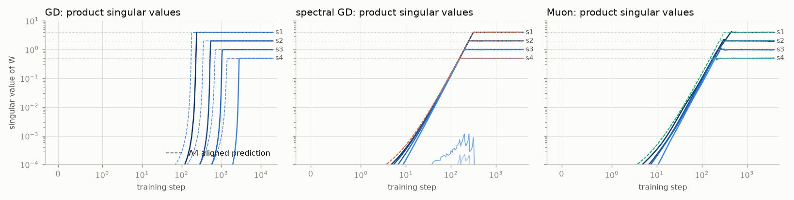
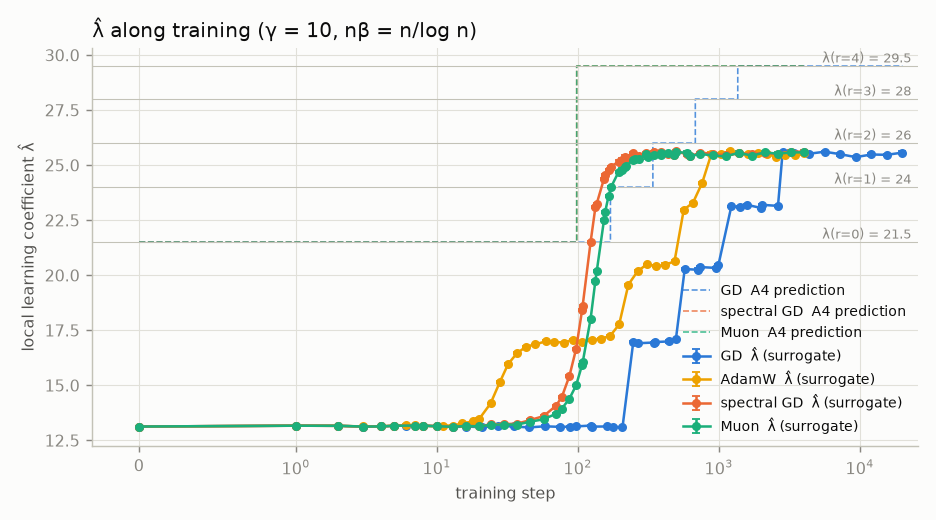
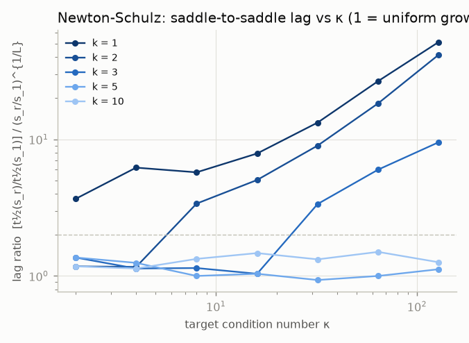

# Deep linear networks: GD, spectral GD and Muon through the learning coefficient

A depth-3 linear network `W = W_3 W_2 W_1` with widths (8, 8, 8, 8), trained to a rank-4 target, is
the one setting where both sides of the question are known in closed form. Gradient descent from a
small initialisation learns the singular values of the target one at a time (saddle to saddle), and
the learning coefficient of the rank-r plateau is known exactly (Aoyagi 2024). Spectral GD, the
idealised form of Muon, should grow all singular values together and so pass from rank 0 to rank 4
in one move. This report checks those predictions, estimates λ along four trajectories (GD, AdamW,
spectral GD, full Muon), and tests what each ingredient of Muon does on its own.

Every number comes from the tables in this directory, written by the `dln` stage of
`scripts/run_all.py` (RTX 4070 desktop; training on the CPU, sampling on the GPU; timings under Reproduce).

The experiments keep the identifiers of the plan they were designed under:

| ID | Experiment | Directory |
|---|---|---|
| B2 | static calibration: λ̂ at constructed rank-r minima against Aoyagi's values | `b2_gibbs/`, `b2_static/`, `b2_long/` |
| B3 | where the offset of B2 comes from: the same points under longer MALA chains and a Gibbs sampler | `b3_offset/` |
| C1 | GD and AdamW against spectral GD: singular values and λ̂ along training | `c1_gd/`, `c1_adamw/`, `c1_spectral/`, `c1_adamw_lr/`, figures in `c1/` |
| C2 | one ingredient of Muon at a time: Newton–Schulz steps, weight decay, momentum | `c2_ns_steps/`, `c2_weight_decay/`, `c2_momentum/` |
| C3 | full Muon, and all four optimizers on one figure | `c3_full_muon/`, figures in `c3/` |

In the figure legends, "A4 prediction" is the closed-form trajectory from `theory/dynamics.py`.

## Summary

1. **The dynamics are as predicted.** GD learns the four singular values at steps 240, 540, 1040
   and 2780, with plateaus in between. Spectral GD grows all four at the same rate and has them all
   at half their target between steps 133 and 252.
2. **λ̂ along training separates the two.** With the surrogate estimator, GD shows four distinct
   steps at the four moments a singular value is learned; spectral GD and full Muon show a single
   rise with no intermediate plateau. All four optimizers end at the same value (25.5 at the
   headline resolution).
3. **AdamW is on GD's side.** It learns the singular values one at a time (steps 50, 260, 540,
   780), in the same order at every learning rate from 0.001 to 0.01, and λ̂ rests on the same four
   intermediate levels as under GD, to within 0.2. Normalising each coordinate of the gradient
   does not remove the plateaus; orthogonalising it does.
4. **Full Muon behaves like spectral GD here.** Momentum, five Newton–Schulz steps and weight decay
   0.1 delay the rise by about 20 % and change nothing else that these measurements see.
5. **The learning coefficient of the actual loss on a plateau was not measured.** A plateau is a
   saddle. A weakly localised chain leaves it and reports the loss drop to the minimum (−2153,
   −511, −100 on the first three GD plateaus); a chain localised strongly enough to stay resolves
   only the curved directions. No localisation strength in the sweep avoids both.
6. **Calibration: Aoyagi's values are confirmed, and the estimate sits below them by a known
   amount.** At constructed minima of known rank the Gibbs estimate at nβ = 205 reads 0.4 to 0.9
   low at γ = 0.1 and 1.3 to 1.5 low at γ = 1; at 100 × nβ it is within 0.14 of the
   finite-temperature prediction λ − (m − 1)/log nβ. The intercept of the ladder fit recovers
   λ to 0.3 at 10 × and 100 × nβ. An earlier version of this project sampled with MALA and read
   1.5 low at γ = 0.1; B3 shows that 0.5 to 1.2 of that was MALA not converging, which chains
   thirty times longer did not fully cure. Every estimate along the trajectories is now made with
   the Gibbs sampler.
7. **Ablations.** Fewer Newton–Schulz steps bring the staircase back above a condition number that
   grows with the number of steps (under 2, 5.7, 24 for k = 1, 2, 3; none up to 128 for k = 5, 10).
   Weight decay caps the product singular values at λ_wd^(−L) to four digits. Momentum does not
   change how uniformly the singular values grow. The predicted scaling of the residual
   oscillation with the learning rate was not confirmed, and the measurement used may not be able
   to see it.

## Setup

| | |
|---|---|
| Model | `W = W_3 W_2 W_1`, widths (8, 8, 8, 8), 192 parameters, `W_l ~ N(0, 0.01²)` |
| Target | `A* = U diag(4, 2, 1, 0.5, 0, 0, 0, 0) Vᵀ`, seeded random orthogonal U, V |
| Data | n = 1024 Gaussian inputs, exactly whitened; noiseless targets, so `L_n = ½‖W − A*‖²_F` |
| GD | plain gradient descent, lr 0.05, 20 000 steps |
| AdamW | lr 0.003, β = (0.9, 0.999), no weight decay, 4000 steps |
| Spectral GD | exact polar factor of each layer's gradient, lr 0.005, no momentum, no decay, 4000 steps |
| Full Muon | Nesterov momentum 0.95, Newton–Schulz k = 5 (float32), decoupled weight decay 0.1, lr 0.005, 4000 steps |
| Seeds | one initialisation and one target, shared by the four optimizers |
| λ̂ | `nβ(E[L_n(w)] − L_n(w₀))` under `exp(−nβ L_n(w) − γ/2‖w − w₀‖²)`, at 50 to 56 checkpoints per run and seven values of γ from 1 to 1000 |
| Chains | Gibbs: 16 chains, 200 burn-in and 500 recorded sweeps, double precision. SGLD: 16 chains, 200 and 1000 steps |

Aoyagi's learning coefficient for these widths (`theory/aoyagi.py`, checked against Theorem 1 of
Lau et al. 2025):

| rank r | 0 | 1 | 2 | 3 | 4 |
|---|---|---|---|---|---|
| λ | 21.5 | 24 | 26 | 28 | 29.5 |
| multiplicity m | 3 | 3 | 1 | 3 | 3 |

Estimators, as named in the `estimator` column of the `llc.csv` files:

- `gibbs`: block Gibbs sampling (`dln/gibbs.py`), 16 chains, on a ladder of 8 inverse
  temperatures. Given the other two layers the loss is quadratic in a layer, so each layer is
  drawn exactly from its conditional: no step size and no rejection. The value reported is the
  rung at nβ = 205, which is 1.39 × n/log n (the ladder has an even number of rungs and none sits
  exactly at n/log n; figure titles say n/log n). `mala`, full-batch Metropolis-adjusted
  Langevin on the same ladder, is what this project used first; it appears only in B2 and B3.
- `sgld`: minibatch SGLD at nβ = n/log n = 148, 16 chains.
- `surrogate`: `gibbs` on a different problem, the one whose true map is the checkpoint's own
  product `W_t`. The checkpoint is then a global minimum, so the chain has nowhere lower to go.
  This measures the learning coefficient of the function the network currently computes, which is
  Aoyagi's λ at the rank of `W_t`. It is **not** the learning coefficient of the training loss at
  that checkpoint.
- `surrogate_hessian`: half the number of curved directions of the surrogate problem that the
  localisation resolves, `½ Σ nβh/(nβh + γ)` over Hessian eigenvalues h. A lower bound that a chain
  reaches if it explores nothing but the curved directions.

## B2: static calibration

For each rank r the target is truncated to its top r singular values and balanced weights with
exactly that product are constructed, so the point is a global minimum of known λ.



`gibbs`, nβ = 205, 500 burn-in and 2000 recorded sweeps (`b2_gibbs/b2.csv`; standard errors 0.01
to 0.04):

| rank | Aoyagi λ | λ̂, γ = 0.1 | difference | λ̂, γ = 1 | λ̂, γ = 10 | λ̂, γ = 100 | half the Hessian rank | ladder intercept, γ = 0.1 |
|---|---|---|---|---|---|---|---|---|
| 0 | 21.5 | 21.1 | −0.4 | 20.0 | 13.1 | 0.4 | 0 | 21.4 |
| 1 | 24 | 23.5 | −0.5 | 22.6 | 16.9 | 7.2 | 7.5 | 23.9 |
| 2 | 26 | 25.5 | −0.5 | 24.8 | 20.3 | 12.7 | 14 | 26.2 |
| 3 | 28 | 27.2 | −0.8 | 26.7 | 23.2 | 16.5 | 19.5 | 28.3 |
| 4 | 29.5 | 28.6 | −0.9 | 28.2 | 25.5 | 18.9 | 24 | 30.3 |

What this shows:

- **The order, the spacing and nearly the level are right.** Consecutive ranks differ by 2.4, 2.0,
  1.7, 1.4 where Aoyagi gives 2.5, 2, 2, 1.5. Every rank reads 0.4 to 0.9 low at γ = 0.1, and B3
  shows that this is the estimator at this temperature, not an error.
- **The estimate approaches Aoyagi's value as γ/nβ → 0**, which is what the theory asks for. At
  γ = 0.1 the five ranks read 21.1, 23.5, 25.5, 27.2, 28.6 at nβ = 205; 21.2, 23.7, 25.8, 27.5,
  29.0 at 10 × nβ; and 21.3, 23.8, 25.9, 27.7, 29.2 at 100 × nβ.
- **The ladder intercept recovers λ.** Fitting nβ·E[ΔL] against 1/log nβ over the eight rungs and
  reading the intercept gives 21.4, 23.9, 26.2, 28.3, 30.3 around nβ = 205, and 21.5, 24.0, 26.1,
  28.1, 29.7 around 100 × nβ. That is within 0.3 of Aoyagi at 10 × nβ and above; around nβ = 205
  rank 4 is 0.8 high and the others within 0.3.
- **The slope of that fit is not the multiplicity.** It gives m̂ of 2.3 to 2.9 at rank 0 (true
  value 3) but 3.2 to 3.9, 3.7 to 4.6, 5.3 to 6.7 and 6.1 to 10.3 at ranks 1 to 4, against 3, 1,
  3, 3. The higher-order terms that B3 finds at the higher ranks go into the slope.
- **Localisation costs 1 at γ = 1 and 3 to 8 at γ = 10.** λ̂ falls by 0.4 to 1.1 from γ = 0.1 to
  γ = 1 and by a further 2.7 to 6.9 to γ = 10, the headline setting of the trajectories.
- **Strong localisation counts curved directions only.** At γ = 100 the estimate has fallen to within
  0.4 of half the Hessian rank, or below it. The remaining 5.5 to 21.5 of λ comes from directions
  in which the loss is flat to second order, and a chain confined near the centre does not see them.

### The same calibration under MALA

This is what the project measured before the Gibbs sampler, kept because B3 explains it. MALA
with 2000 burn-in and 12 000 recorded steps (`b2_long/`) and with chains eight times shorter
(`b2_static/`, 400 and 1500). `mala`, nβ = 205, long chains (`b2_long/b2.csv`; standard errors
0.1 to 0.3):

| rank | Aoyagi λ | λ̂, γ = 0.1 | difference | λ̂, γ = 1 | λ̂, γ = 10 | λ̂, γ = 100 |
|---|---|---|---|---|---|---|
| 0 | 21.5 | 20.1 | −1.4 | 19.9 | 13.1 | 0.4 |
| 1 | 24 | 22.3 | −1.7 | 21.9 | 16.9 | 7.3 |
| 2 | 26 | 24.8 | −1.3 | 24.3 | 20.2 | 12.6 |
| 3 | 28 | 26.6 | −1.4 | 26.4 | 23.2 | 16.5 |
| 4 | 29.5 | 27.8 | −1.7 | 28.1 | 25.5 | 18.9 |

MALA agrees with Gibbs from γ = 10 up and falls below it as the localisation weakens: by 0.1 to
0.7 at γ = 1 and by 0.6 to 1.2 at γ = 0.1. Its ladder fit for the multiplicity gave 0.5, −0.7,
3.3, 2.5, 8.5.

### What chain length does to MALA

The step size of the sampler shrinks as nβ grows, so in a fixed number of steps a chain covers
less of the flat directions, and those are where most of λ lives. γ = 0.1:

| rank | Aoyagi λ | nβ = 205, short | nβ = 205, long | nβ = 2053, short | nβ = 2053, long |
|---|---|---|---|---|---|
| 0 | 21.5 | 19.5 | 20.1 | 19.4 | 20.4 |
| 1 | 24 | 22.0 | 22.3 | 17.8 | 22.0 |
| 2 | 26 | 24.0 | 24.8 | 20.0 | 24.2 |
| 3 | 28 | 25.8 | 26.6 | 22.8 | 26.2 |
| 4 | 29.5 | 27.6 | 27.8 | 26.4 | 28.1 |

- **With short chains λ̂ fell as nβ rose**, down to half the Hessian rank at 100 × nβ (9.0, 14.7,
  19.8, 24.1 for ranks 1 to 4). The opposite was expected: the estimate should approach Aoyagi's
  value as γ/nβ → 0. The short-chain fit for the multiplicity ranged from −128 to 112.
- **Long chains remove that dependence up to 10 × nβ.** The two long columns agree to 0.6. An
  (Gibbs rises by 0.1 to 0.4 over the same decade.)
  At 100 × nβ the long chains fall short again (20.0, 22.6, 25.1, 27.0 for ranks 1 to 4), so the
  same problem returns one decade higher.
- **Chain length is not the whole reason for the offset.** At nβ = 205 the long chains gain 0.1
  to 0.8 and the mean distance to Aoyagi's values goes from 2.0 to 1.5. B3 below takes the
  remaining 1.5 apart.

## B3: where the offset comes from

The points of B2 at γ = 0.1 and 1, in double precision, sampled six ways
(`configs/dln/b3_offset.yaml`, 16 chains each). If the chains are converged, all six agree.

| Arm | Sampler | Start | Burn-in + recorded |
|---|---|---|---|
| A | MALA as in `b2_long` | centre | 2000 + 12 000 steps |
| B | MALA, adaptation gain decaying as 1/√i | centre | 20 000 + 400 000 steps |
| C, C2 | as B | off the centre, at nβΔL = 100 and 3000 | 20 000 + 400 000 steps |
| D, D2 | block Gibbs: each layer drawn exactly given the other two | centre, and nβΔL = 100 | 5000 + 50 000 sweeps |

The Gibbs sampler has no step size and no rejection, so it does not share MALA's way of failing.
It is checked in `tests/test_dln_gibbs.py` against a quadrature of the 1-1-1-1 network and
against MALA on a small problem where MALA mixes.



γ = 0.1 (`b3_offset/offset_summary.txt`). Standard errors: A 0.1 to 0.3, B 0.1 to 0.2, D 0.01.
"Predicted" is λ − (m − 1)/log nβ with m = 3, 3, 1, 3, 3.

| rank | Aoyagi λ | predicted, nβ = 205 | A | B | C | D | D2 | predicted, 100 × nβ | B | D |
|---|---|---|---|---|---|---|---|---|---|---|
| 0 | 21.5 | 21.10 | 20.01 | 20.67 | 20.59 | 21.10 | 21.09 | 21.29 | 20.67 | 21.28 |
| 1 | 24 | 23.60 | 22.31 | 23.17 | 23.13 | 23.48 | 23.47 | 23.79 | 22.81 | 23.72 |
| 2 | 26 | 26.00 | 24.33 | 25.15 | 24.97 | 25.50 | 25.49 | 26.00 | 25.35 | 25.86 |
| 3 | 28 | 27.60 | 26.65 | 26.90 | 26.98 | 27.16 | 27.17 | 27.79 | 27.17 | 27.66 |
| 4 | 29.5 | 29.10 | 27.84 | 28.50 | 28.21 | 28.51 | 28.50 | 29.29 | 28.76 | 29.15 |

What this shows:

- **Aoyagi's values are the right reference.** The two Gibbs arms agree to 0.03 everywhere, with
  split R̂ of 1.000 and 160 000 effective draws. At rank 0 they sit on the prediction at all three
  temperatures (21.10, 21.23, 21.28 against 21.10, 21.23, 21.29). At 100 × nβ every rank is
  within 0.14 of it.
- **0.4 to 1.0 of the offset is the estimator, not the sampler.** At nβ = 205 the exact posterior
  mean is below λ by 0.40, 0.52, 0.50, 0.84, 0.99 for ranks 0 to 4. The (m − 1)/log nβ term
  accounts for 0.4 of it (0 at rank 2); the rest grows with rank and is gone by 100 × nβ, so it
  is a higher-order term in the temperature. The 1-1-1-1 network, done by quadrature
  (`b3_offset/scalar_chain.csv`), shows the same thing with no sampler at all: λ = 0.5, and the
  exact value at γ = 0.1 is 0.36 at nβ = 205 and still 0.41 at nβ = 10⁶.
- **The rest, 0.5 to 1.2, is MALA.** Arm A is below Gibbs by 1.09, 1.17, 1.17, 0.51, 0.67. Chains
  thirty times longer close most of that but not all: B and C are still 0.3 to 0.5 below Gibbs
  at ranks 0 to 2, and 0.4 to 0.9 below at 100 × nβ.
- **The usual diagnostics do not catch it.** B, C and C2 agree with each other within their
  errors, starting from below and from above, with R̂ under 1.02. They agree on a value that is
  too low. What does show the problem is the acceptance rate: 0.53 at the end of burn-in while
  the step size still adapts, 0.08 to 0.13 once it is frozen. One step size for the whole chain
  does not fit a posterior whose scale changes along the flat directions.
- **Localisation is not negligible at γ = 1.** There Gibbs reads 19.93, 22.46, 24.68, 26.54, 28.05
  at nβ = 205, which is 1.2 to 0.5 below its γ = 0.1 values, and long MALA agrees with it to
  0.05. B2 had γ = 0.1 and γ = 1 reading the same under MALA, which looked like localisation
  not mattering; it was the localisation effect at γ = 1 and the sampler error at γ = 0.1 being
  the same size.
- **A chain started far off can stay there.** C2 at 100 × nβ starts at nβΔL of 300 000 and at six
  of the ten points some chains never come down (λ̂ in the tens of thousands, R̂ in the tens of
  thousands). Those cells are a failed run, not an estimate.

What follows for the rest of this report: every ladder estimate below is made with the Gibbs
sampler, which applies wherever the loss is ½‖W − A‖². That covers the surrogate estimate and
the loss itself. At 200 + 500 sweeps it is also cheaper than the 14 000 MALA steps it replaces.
The levels on the trajectories are therefore those of the Gibbs calibration in B2: below
Aoyagi's value by the temperature and localisation terms, with no sampler error on top.

## C1: GD and AdamW against spectral GD



Step at which each singular value of the product first reaches half its target
(`trajectory.csv` of each run; logged every 20 steps, or more often around the predicted times):

| | s₁ = 4 | s₂ = 2 | s₃ = 1 | s₄ = 0.5 |
|---|---|---|---|---|
| GD, measured | 240 | 540 | 1040 | 2780 |
| GD, predicted for an aligned initialisation | 177 | 354 | 707 | 1414 |
| AdamW, measured (no prediction) | 50 | 260 | 540 | 780 |
| spectral GD, measured | 252 | 200 | 160 | 133 |
| spectral GD, predicted | 312 | 246 | 194 | 153 |
| full Muon, measured (C3) | 300 | 240 | 194 | 160 |

Under GD each singular value waits for the previous one, and each wait is longer than the last.
The measured times are 1.4 to 2 times the prediction, which assumes the initial weights are
already aligned with the target's singular vectors; a random initialisation has to find them
first. Under spectral GD the four curves lie on top of each other until each reaches its target
(at step 100 they are 0.141, 0.140, 0.135, 0.126), so the smallest target is reached first and
the order is the reverse of GD's.

AdamW learns them largest first, one at a time, like GD. The scan over learning rates
(`c1_adamw_lr/summary.csv`, training only) gives the same order at all four:

| AdamW lr | s₁ | s₂ | s₃ | s₄ | lag ratio (1 = uniform) |
|---|---|---|---|---|---|
| 0.001 | 120 | 560 | 1250 | 1880 | 31 |
| 0.003 | 50 | 250 | 535 | 780 | 31 |
| 0.005 | 35 | 135 | 400 | 815 | 47 |
| 0.01 | 20 | 80 | 245 | 370 | 37 |

(The scan logs every 5 steps and the main run every 20, hence 250 and 535 here against 260 and
540 above.) Adam divides each coordinate of the gradient by its running scale. That makes it
fast, but it does not equalise the singular values of the gradient, and the small directions
still wait.

Spectral GD and Muon do not converge to zero loss at a fixed step size. Spectral GD stops at a
loss of 2.3e-4 with s₁ = 4.016, and Muon oscillates between 4e-5 and 7e-4. At nβ ≈ 200 that is
0.05 to 0.15 in units of λ̂ and does not affect what follows.

### λ̂ along the GD trajectory

Medians over the checkpoints of each plateau (`c1_gd/llc.csv`; standard errors under 0.08 for
`surrogate`):

| plateau (steps) | Aoyagi λ | `surrogate`, γ = 1 | `surrogate`, γ = 10 | `gibbs` on the loss, γ ≤ 10 | `gibbs` on the loss, γ = 1000 | `surrogate_hessian`, γ = 1 |
|---|---|---|---|---|---|---|
| rank 0 (0 to 207) | 21.5 | 20.0 | 13.1 | −2153 | −0.1 | 0.0 |
| rank 1 (247 to 495) | 24 | 22.6 | 17.0 | −511 | 4.3 | 7.5 |
| rank 2 (572 to 990) | 26 | 24.8 | 20.3 | −100 | 6.8 | 14.0 |
| rank 3 (1224 to 2623) | 28 | 26.7 | 23.1 | 0.6 to 2.5 | 8.2 | 19.4 |
| rank 4 (2828 on) | 29.5 | 28.2 | 25.5 | 25.5 to 28.2 | 8.9 | 23.9 |

- **`surrogate` gives the staircase.** Four steps, each between two consecutive checkpoints that
  bracket the moment a singular value is learned (207 to 247, 495 to 572, 990 to 1224, 2623 to
  2828), and flat to within 0.25 in between. Step heights are 2.6, 2.2, 1.9, 1.5 at γ = 1,
  against 2.5, 2, 2, 1.5 from Aoyagi, and 3.9, 3.3, 2.8, 2.4 at γ = 10. The levels at γ = 1 are
  1.2 to 1.5 below Aoyagi's and equal to the calibration at γ = 1 to 0.1 (20.0, 22.6, 24.8, 26.7,
  28.2 in B2): each plateau reads what a constructed minimum of that rank reads.
- **`gibbs` on the training loss measures the depth of the basin, not λ.** For γ ≤ 10 the value on
  plateau r equals the end value minus nβ times the loss still to be gained: adding
  nβ(L_plateau − L_min) back gives 28.2, 28.3, 28.2 and 28.2 on plateaus 0 to 3, against 28.2
  measured at the end. The chain has left the plateau and equilibrated in the basin of the
  solution. `sgld` does the same (−1530, −347, −51 at its lower nβ).
- **Held in place, the chain reads below the curved-direction count.** At γ = 1000 nothing escapes
  and λ̂ rises in four steps, but from −0.1 to 8.9. At that strength the localisation term swamps
  most of the curvature too.
- **In between there is no good setting.** γ = 100 escapes on plateaus 0 and 1 and is still
  negative on plateau 2; γ = 300 holds everything but the initial plateau and reads 5.5, 10.2,
  13.0, 14.5. The escape threshold moves with the size of the next singular value, so the γ that
  just holds one plateau is too weak for the one before it. `c1/c1_family_gibbs.png` shows the
  whole family.
- **This is a property of the posterior, not of the sampler.** MALA gave the same escapes and the
  same values to within 1; an exact sampler leaves the plateau just the same.

### λ̂ along the AdamW trajectory

`surrogate` rests on the same levels as under GD (`c1_adamw/llc.csv`):

| | rank 0 | rank 1 | rank 2 | rank 3 | rank 4 |
|---|---|---|---|---|---|
| GD, γ = 1 | 20.0 | 22.6 | 24.8 | 26.7 | 28.2 |
| AdamW, γ = 1 | 20.0 | 22.6 | 24.8 | 26.6 | 28.2 |
| GD, γ = 10 | 13.1 | 17.0 | 20.3 | 23.1 | 25.5 |
| AdamW, γ = 10 | 13.2 | 17.0 | 20.5 | 23.1 | 25.5 |
| AdamW, checkpoints on the plateau | 0 to 15 | 50 to 169 | 265 to 484 | 563, 655 | 885 on |

The plateaus are shorter than GD's and the third has only two checkpoints on it, but all four
are there. `gibbs` on the training loss shows the same escapes as under GD (−516 and −100 on the
rank 1 and rank 2 plateaus).

### λ̂ along the spectral GD trajectory

`surrogate` at γ = 10 stays within 0.5 of 13.1 up to step 57, then rises through 16.6 (step 97)
and 23.1 (step 133) to 25.2 (step 194), and stays there. The values at which GD and AdamW rest
(17.0, 20.3, 23.1) are passed without stopping. `gibbs` on the training loss is negative until
step 272 and reads 27.6 to 28.2 at γ = 1 from step 312 on.

## C3: full Muon



`surrogate` at γ = 10 goes from 13.1 to 25.5 in one rise, through 15.0 (step 97), 19.8 (133) and
24.7 (194): the same shape as spectral GD, about 20 steps later at its midpoint. The singular
values reach half their targets 1.2 times later than under spectral GD and in the same order.

End of training, median over the last checkpoints:

| | `surrogate`, γ = 10 | `surrogate`, γ = 1 | `gibbs` on the loss, γ = 1 | `sgld` on the loss, γ = 1 |
|---|---|---|---|---|
| GD | 25.5 | 28.2 | 28.2 | 40.3 |
| AdamW | 25.5 | 28.2 | 28.2 | 40.8 |
| spectral GD | 25.6 | 28.2 | 28.2 | 41.0 |
| full Muon | 25.6 | 28.2 | 28.2 | 40.6 |

The four optimizers end at the same solution as far as λ̂ can tell, which is what the theory says
for a rank-4 minimum reached from any direction, and at the end of training the estimate on the
loss and the surrogate estimate coincide. `sgld` reads 12 above `gibbs` at γ = 1, 4 above at
γ = 10 and 1.3 above at γ = 100. The two run at different temperatures (nβ = 148 and 205), but
B2 shows a tenfold change of temperature moves the exact value by under 1; a gap of 12 is the discretisation and minibatch noise of SGLD
at weak localisation.

## C2: one ingredient at a time

Singular-value observables only; no λ̂ was estimated in the sweeps.

### Newton–Schulz steps

Spectral update with k Newton–Schulz steps instead of the exact polar factor, on targets with
condition number κ from 2 to 128. The lag ratio is the delay of the smallest singular value
relative to the largest, divided by what uniform growth predicts: 1 for uniform growth, large for
a staircase (`c2_ns_steps/summary.csv`).



| k | κ = 2 | 4 | 8 | 16 | 32 | 64 | 128 | breakdown κ* (lag ratio 2) |
|---|---|---|---|---|---|---|---|---|
| 1 | 3.7 | 6.2 | 5.7 | 7.9 | 13 | 27 | 52 | below 2 |
| 2 | 1.2 | 1.2 | 3.4 | 5.0 | 9.0 | 18 | 42 | 5.7 |
| 3 | 1.4 | 1.1 | 1.1 | 1.0 | 3.4 | 6.0 | 9.5 | 24 |
| 5 | 1.4 | 1.3 | 1.0 | 1.0 | 0.9 | 1.0 | 1.1 | none up to 128 |
| 10 | 1.2 | 1.1 | 1.3 | 1.5 | 1.3 | 1.5 | 1.3 | none up to 128 |

The prediction is that singular values of the normalised gradient below about a^(−k), a = 3.4445,
are amplified but not flattened, so uniform growth fails above κ* ∝ a^k: a factor 3.44 per step.
Between k = 2 and k = 3 the measured factor is 4.1. `ns_summary.txt` reports a fitted slope of
1.233 against a predicted 1.237, but that fit includes k = 1, whose κ* is the bottom of the grid
and not a measurement; the two measured points alone give 1.42. The law is supported in
direction and roughly in size, on two points. Muon's k = 5 is uniform over the whole range
tested, which is why C3 looks like C1.

### Weight decay

Exact orthogonalisation with decoupled weight decay λ_wd, depths L = 2, 3, 4, three learning
rates. Prediction: each layer's spectral norm settles at 1/λ_wd, so product singular values are
capped at λ_wd^(−L) whatever the learning rate.

| | measured final s₁ | λ_wd^(−L) |
|---|---|---|
| L = 2, λ_wd = 0.6 | 2.7778 | 2.7778 |
| L = 3, λ_wd = 0.7 | 2.9155 | 2.9155 |
| L = 4, λ_wd = 0.8 | 2.4414 | 2.4414 |
| L = 4, λ_wd = 1.5 | 0.19753 | 0.19753 |

The log-log slope of the cap against λ_wd is −2.000, −3.000, −4.000 at every learning rate
(`c2_weight_decay/wd_summary.txt`), and the spread across learning rates is below 1.3e-4. Where the cap is
above the target, s₁ ends at 3.95 to 3.99. This one holds exactly.

### Momentum

Exact orthogonalisation with Nesterov momentum μ from 0 to 0.99, three initialisation scales,
three learning rates.

- **Uniform growth is unaffected by momentum.** The uniformity ratio (s₄/s₁ when s₄ reaches half
  its target; 1 is perfectly uniform) is 0.97 to 0.98 at initialisation scale 0.001, 0.91 to 0.92
  at 0.01 and 0.44 to 0.49 at 0.1, for every μ. It is set by the initialisation, not the momentum.
  Half-target times move by at most 3 % across μ.
- **The amplitude law is not confirmed.** The prediction is a residual oscillation at saturation
  proportional to the learning rate. The fitted exponents are 0.52, 1.88, 3.42, 1.11, 0.65 for
  μ = 0, 0.5, 0.9, 0.95, 0.99, with R² from 0.27 to 0.99. The measured amplitudes are 5e-7 to 6e-4
  for μ ≤ 0.95, far below the predicted L·η·s^((L−1)/L) of 0.008 to 0.08. The amplitude is the
  standard deviation of singular values logged every 20 steps, which cannot see an oscillation
  of period 2, so this result may say more about the measurement than about the law. Only
  μ = 0.99 shows a visible residual (2e-3 to 8e-3 averaged over initialisation scales).

## What can and cannot be concluded

Can:

- GD and AdamW pass through four plateaus and spectral GD and Muon through none, in the singular
  values and in λ̂ of the function being computed.
- The step in λ̂ at each GD or AdamW transition is positive and of the size Aoyagi's table gives,
  to within 0.5 at γ = 1 (2.6, 2.2, 1.9, 1.5 against 2.5, 2, 2, 1.5).
- Muon with five Newton–Schulz steps is on the uniform side of the breakdown for condition
  numbers up to 128, and weight decay acts as a hard cap.

Cannot:

- That the learning coefficient **of the training loss** rises in steps under GD. The estimator
  that shows the staircase is defined on a surrogate problem. On the loss itself, plateaus are
  saddles and every setting either escaped or under-resolved.
- A reading of λ itself at the temperature and localisation used on the trajectories. At γ = 1
  and nβ = 205 the estimate is 1.3 to 1.5 below Aoyagi's value, and at the headline γ = 10 it is
  4 to 8 below. Both gaps are measured on constructed minima (B2) and are the same on the
  trajectories, so levels can be compared with the calibration but not read off as λ.
- Anything about variability: one seed, one target, one initialisation scale for the four
  trajectories, and one learning rate for the AdamW estimates.

Other limits:

- The count of negative Hessian eigenvalues in `llc.csv` (`n_neg_hessian`) is not usable. It
  reports dozens at the converged GD minimum, where there are none: float32 noise around zero.
- The Gibbs sampler exists only because this loss is quadratic in each layer. It does not carry
  over to a nonlinear network, where MALA's failure in B3 (one step size for a posterior whose
  scale changes along the flat directions, and diagnostics that do not show it) would have to be
  met another way.
- AdamW's checkpoints are log-spaced only, since there is no prediction to place them around.

## Reproduce

```bash
uv sync --extra dev
```

```bash
uv run python scripts/run_all.py --stages dln
```

| Step | Module (`muon_llc.dln.experiments.`) | Device | Minutes |
|---|---|---|---|
| B2: MALA short, MALA long, Gibbs | `static_dln` | GPU | 3.1, 13, 11 |
| B3, six arms side by side | `offset_study` | GPU | 1.7 (A), 81 (B, C, C2), 25 (D, D2) |
| Training, four runs | `train` | CPU | 0.3 to 0.4 each |
| Estimates, four runs | `estimate` | GPU | 10 to 12 each, run one at a time |
| C2 sweeps and the AdamW scan | `sweep` (Newton–Schulz, weight decay, momentum, AdamW lr) | CPU | 16, 19, 2.8, 0.5 |
| Figures, tables | `plot_c1`, `plot_c3`, `analyze_c2`, `collect` | CPU | under 1 |

Each Gibbs estimate takes about 2 GB of GPU memory with `llc.gibbs.max_centres: 16`. At 64 pairs
per call four runs side by side need about 18 GB, which exhausts a 12 GB card and spills into
system memory. The stage as a whole has not been timed since B3 and the Gibbs estimates were
added: with MALA estimates it took 49 minutes, and the long MALA arms of B3 alone take 81. Each
sampler draws its noise on one CPU core, which is what keeps a seed reproducible across devices.
