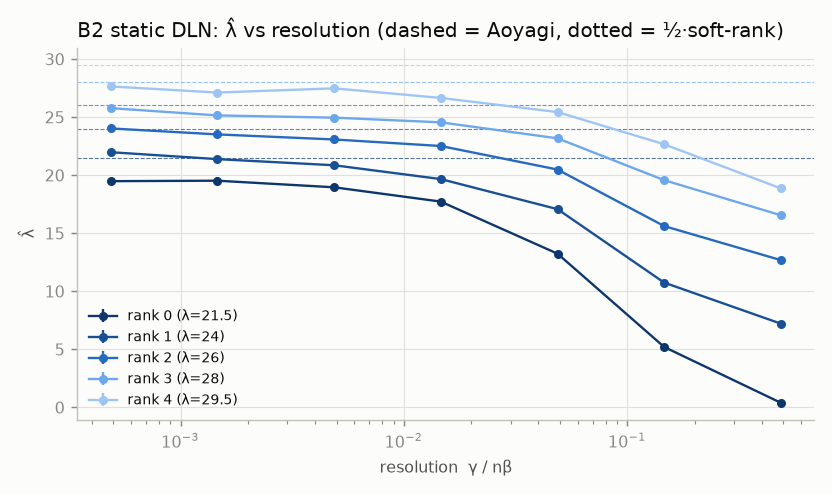
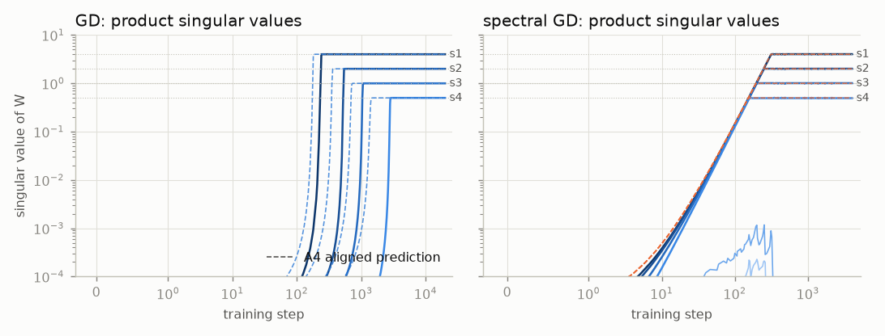

# Deep linear networks: GD, spectral GD and Muon through the learning coefficient

A depth-3 linear network `W = W_3 W_2 W_1` with widths (8, 8, 8, 8), trained to a rank-4 target, is
the one setting where both sides of the question are known in closed form. Gradient descent from a
small initialisation learns the singular values of the target one at a time (saddle to saddle), and
the learning coefficient of the rank-r plateau is known exactly (Aoyagi 2024). Spectral GD, the
idealised form of Muon, should grow all singular values together and so pass from rank 0 to rank 4
in one move. This report checks those predictions, estimates λ along the three trajectories, and
tests what each ingredient of Muon does on its own.

Every number comes from the tables in this directory, written by the `dln` stage of
`scripts/run_all.py` (17 minutes on an RTX 4070 desktop; training on the CPU, sampling on the GPU),
plus one longer calibration run made afterwards (`b2_long/`, 8 minutes).

The experiments keep the identifiers of the plan they were designed under:

| ID | Experiment | Directory |
|---|---|---|
| B2 | static calibration: λ̂ at constructed rank-r minima against Aoyagi's values | `b2_static/`, `b2_long/` |
| C1 | GD against spectral GD: singular values and λ̂ along training | `c1_gd/`, `c1_spectral/`, figures in `c1/` |
| C2 | one ingredient of Muon at a time: Newton–Schulz steps, weight decay, momentum | `c2_ns_steps/`, `c2_weight_decay/`, `c2_momentum/` |
| C3 | full Muon overlaid on C1 | `c3_full_muon/`, figures in `c3/` |

In the figure legends, "A4 prediction" is the closed-form trajectory from `theory/dynamics.py`.

## Summary

1. **The dynamics are as predicted.** GD learns the four singular values at steps 240, 540, 1040
   and 2780, with plateaus in between. Spectral GD grows all four at the same rate and has them all
   at half their target between steps 133 and 252.
2. **λ̂ along training separates the two.** With the surrogate estimator, GD shows four distinct
   steps at the four moments a singular value is learned; spectral GD and full Muon show a single
   rise with no intermediate plateau. All three end at the same value (25.0 to 25.4 at the headline
   resolution).
3. **Full Muon behaves like spectral GD here.** Momentum, five Newton–Schulz steps and weight decay
   0.1 delay the rise by about 20 % and change nothing else that these measurements see.
4. **The learning coefficient of the actual loss on a plateau was not measured.** A plateau is a
   saddle. A weakly localised chain leaves it and reports the loss drop to the minimum (−2149,
   −511, −100 on the first three GD plateaus); a chain localised strongly enough to stay resolves
   only the curved directions. No localisation strength in the sweep avoids both.
5. **Absolute values are not calibrated.** At constructed minima of known rank, the best setting
   reads 2.0 below Aoyagi's value at every rank. The spacing between ranks is reproduced to 0.4.
   Chains eight times longer make the estimate independent of temperature, as it should be, and
   reduce the offset to 1.6; the rest is unexplained. So differences in λ̂ along a trajectory are
   trustworthy to a few tenths; its level is not.
6. **Ablations.** Fewer Newton–Schulz steps bring the staircase back above a condition number that
   grows with the number of steps (under 2, 5.7, 24 for k = 1, 2, 3; none up to 128 for k = 5, 10).
   Weight decay caps the product singular values at λ_wd^(−L) to four digits. Momentum does not
   change how uniformly the singular values grow. The predicted scaling of the residual
   oscillation with the learning rate was not confirmed, and the measurement used may not be able
   to see it.

## Setup

| | |
|---|---|
| Model | `W = W_3 W_2 W_1`, widths (8, 8, 8, 8), 192 parameters, `W_l ~ N(0, 0.01²)` |
| Target | `A* = U diag(4, 2, 1, 0.5, 0, 0, 0, 0) Vᵀ`, seeded random orthogonal U, V |
| Data | n = 1024 Gaussian inputs, exactly whitened; noiseless targets, so `L_n = ½‖W − A*‖²_F` |
| GD | plain gradient descent, lr 0.05, 20 000 steps |
| Spectral GD | exact polar factor of each layer's gradient, lr 0.005, no momentum, no decay, 4000 steps |
| Full Muon | Nesterov momentum 0.95, Newton–Schulz k = 5 (float32), decoupled weight decay 0.1, lr 0.005, 4000 steps |
| Seeds | one initialisation and one target, shared by the three optimizers |
| λ̂ | `nβ(E[L_n(w)] − L_n(w₀))` under `exp(−nβ L_n(w) − γ/2‖w − w₀‖²)`, at 50 to 56 checkpoints per run and seven values of γ from 1 to 1000 |

Aoyagi's learning coefficient for these widths (`theory/aoyagi.py`, checked against Theorem 1 of
Lau et al. 2025):

| rank r | 0 | 1 | 2 | 3 | 4 |
|---|---|---|---|---|---|
| λ | 21.5 | 24 | 26 | 28 | 29.5 |
| multiplicity m | 3 | 3 | 1 | 3 | 3 |

Estimators, as named in the `estimator` column of the `llc.csv` files:

- `mala`: full-batch Metropolis-adjusted Langevin, 16 chains, on a ladder of 8 inverse
  temperatures. The value reported is the rung at nβ = 205, which is 1.39 × n/log n (the ladder has
  an even number of rungs and none sits exactly at n/log n; figure titles say n/log n).
- `sgld`: minibatch SGLD at nβ = n/log n = 148, 16 chains.
- `surrogate`: `mala` on a different problem, the one whose true map is the checkpoint's own
  product `W_t`. The checkpoint is then a global minimum, so the chain has nowhere lower to go.
  This measures the learning coefficient of the function the network currently computes, which is
  Aoyagi's λ at the rank of `W_t`. It is **not** the learning coefficient of the training loss at
  that checkpoint.
- `surrogate_hessian`: half the number of curved directions of the surrogate problem that the
  localisation resolves, `½ Σ nβh/(nβh + γ)` over Hessian eigenvalues h. A lower bound that a chain
  reaches if it explores nothing but the curved directions.

## B2: static calibration

For each rank r the target is truncated to its top r singular values and balanced weights with
exactly that product are constructed, so the point is a global minimum of known λ.



`mala`, nβ = 205, 400 burn-in and 1500 recorded steps (`b2_static/b2.csv`; standard errors 0.2 to 0.4):

| rank | Aoyagi λ | λ̂, γ = 0.1 | difference | λ̂, γ = 1 | λ̂, γ = 10 | λ̂, γ = 100 | half the Hessian rank |
|---|---|---|---|---|---|---|---|
| 0 | 21.5 | 19.5 | −2.0 | 19.0 | 13.2 | 0.4 | 0 |
| 1 | 24 | 22.0 | −2.0 | 20.9 | 17.1 | 7.2 | 7.5 |
| 2 | 26 | 24.0 | −2.0 | 23.1 | 20.5 | 12.7 | 14 |
| 3 | 28 | 25.8 | −2.2 | 25.0 | 23.2 | 16.5 | 19.5 |
| 4 | 29.5 | 27.6 | −1.9 | 27.5 | 25.4 | 18.9 | 24 |

What this shows:

- **The order and the spacing are right; the level is not.** Consecutive ranks differ by 2.5, 2.0,
  1.8, 1.9 where Aoyagi gives 2.5, 2, 2, 1.5. Every rank reads about 2 low at the weakest
  localisation, and lower still as γ grows.
- **Strong localisation counts curved directions only.** At γ = 100 the estimate has fallen to within
  0.4 of half the Hessian rank, or below it. The remaining 5.5 to 21.5 of λ comes from directions in which the
  loss is flat to second order, and a chain confined near the centre does not see them.
- **Raising nβ made it worse, not better.** The config expected λ̂ to approach Aoyagi's value as
  γ/nβ → 0. At 10 × nβ the γ = 0.1 estimates for ranks 1 to 4 drop to 17.8, 20.0, 22.8, 26.4, and
  at 100 × nβ to 9.0, 14.7, 19.8, 24.1, which is half the Hessian rank again.
- **The ladder fit for the multiplicity is unusable.** The fitted m̂ ranges from −128 to 112 across
  ranks, temperatures and γ (true values 1 and 3).

### Why: the chains are too short

The step size of the sampler shrinks as nβ grows, so in a fixed number of steps a chain covers
less of the flat directions, and those are where the missing part of λ lives. If that is the
cause, longer chains should raise the estimate, most of all at high nβ. `b2_long/` repeats the
calibration with 2000 burn-in and 12 000 recorded steps, eight times the length:

| rank | Aoyagi λ | nβ = 205, short | nβ = 205, long | nβ = 2053, short | nβ = 2053, long |
|---|---|---|---|---|---|
| 0 | 21.5 | 19.5 | 19.8 | 19.4 | 20.3 |
| 1 | 24 | 22.0 | 22.4 | 17.8 | 22.1 |
| 2 | 26 | 24.0 | 24.6 | 20.0 | 24.6 |
| 3 | 28 | 25.8 | 26.4 | 22.8 | 26.3 |
| 4 | 29.5 | 27.6 | 27.7 | 26.4 | 28.2 |

(γ = 0.1; standard errors 0.2 to 0.4 short, 0.1 to 0.3 long; `b2_long/b2.csv`.)

- **Chain length was the reason λ̂ fell with nβ.** At 10 × nβ the long chains read 1.8 to 4.6
  higher than the short ones for ranks 1 to 4, and now agree with the nβ = 205 column to 0.5. An
  estimate that does not move when the temperature changes tenfold is what the theory asks for.
  At 100 × nβ the long chains still fall short (20.1, 22.5, 25.1, 27.1 for ranks 1 to 4), so the
  same problem returns one decade higher.
- **It is not the whole reason for the offset.** At nβ = 205 the long chains gain 0.0 to 0.6. The
  mean distance to Aoyagi's values goes from 2.0 to 1.6, and every rank still reads 1.4 to 1.8
  low. This run does not say where the rest comes from. Candidates are chains still too short for
  the flattest directions, the finite-temperature correction of the estimator (of order
  (m − 1)/log nβ ≈ 0.4 for m = 3), and the Gaussian localisation itself.
- **Spacing is unchanged**: 2.6, 2.2, 1.8, 1.3 between consecutive ranks, against 2.5, 2, 2, 1.5.
- **The multiplicity fit improves and is still not a measurement**: 1.8, 2.0, 2.5, 6.6, 10.1 for
  ranks 0 to 4 at nβ = 205, against 3, 3, 1, 3, 3.

Two more things in the tables point the same way. The acceptance rate after burn-in is 0.2
to 0.3 at γ ≤ 1 against a target of 0.57, in the long run as in the short one: the step size is tuned during a burn-in in which the
chain is still close to its starting point, and is too large once the chain has spread. And the
trajectory estimates below use chains shorter still (300 burn-in, 1000 recorded steps).

## C1: GD against spectral GD



Step at which each singular value of the product first reaches half its target
(`c1_gd/trajectory.csv`, `c1_spectral/trajectory.csv`; logged every 20 steps, or more often
around the predicted times):

| | s₁ = 4 | s₂ = 2 | s₃ = 1 | s₄ = 0.5 |
|---|---|---|---|---|
| GD, measured | 240 | 540 | 1040 | 2780 |
| GD, predicted for an aligned initialisation | 177 | 354 | 707 | 1414 |
| spectral GD, measured | 252 | 200 | 160 | 133 |
| spectral GD, predicted | 312 | 246 | 194 | 153 |
| full Muon, measured (C3) | 300 | 240 | 194 | 160 |

Under GD each singular value waits for the previous one, and each wait is longer than the last.
The measured times are 1.4 to 2 times the prediction, which assumes the initial weights are
already aligned with the target's singular vectors; a random initialisation has to find them
first. Under spectral GD the four curves lie on top of each other until each reaches its target
(at step 100 they are 0.141, 0.140, 0.135, 0.126), so the smallest target is reached first and
the order is the reverse of GD's.

Spectral GD and Muon do not converge to zero loss at a fixed step size. Spectral GD stops at a
loss of 2.3e-4 with s₁ = 4.016, and Muon oscillates between 4e-5 and 7e-4. At nβ ≈ 200 that is
0.05 to 0.15 in units of λ̂ and does not affect what follows.

### λ̂ along the GD trajectory

Medians over the checkpoints of each plateau (`c1_gd/llc.csv`; standard errors 0.1 to 0.4):

| plateau (steps) | Aoyagi λ | `surrogate`, γ = 1 | `surrogate`, γ = 10 | `mala` on the loss, γ ≤ 10 | `mala` on the loss, γ = 1000 | `surrogate_hessian`, γ = 1 |
|---|---|---|---|---|---|---|
| rank 0 (0 to 207) | 21.5 | 18.8 | 13.1 | −2149 | −0.1 | 0.0 |
| rank 1 (247 to 495) | 24 | 20.4 | 16.7 | −511 | 4.3 | 7.5 |
| rank 2 (572 to 990) | 26 | 23.3 | 20.0 | −100 | 6.8 | 14.0 |
| rank 3 (1224 to 2623) | 28 | 25.2 | 22.7 | 1.7 to 2.2 | 8.2 | 19.5 |
| rank 4 (2828 on) | 29.5 | 26.8 | 25.2 | 25.2 to 27.1 | 8.9 | 23.9 |

- **`surrogate` gives the staircase.** Four steps, each between two consecutive checkpoints that
  bracket the moment a singular value is learned (207 to 247, 495 to 572, 990 to 1224, 2623 to
  2828), and flat to within 0.7 in between. Step heights are 1.6 to 2.9 at γ = 1 and 2.5 to 3.6 at
  γ = 10, against 1.5 to 2.5 from Aoyagi. The levels are 2.7 to 3.6 below Aoyagi's at γ = 1,
  consistent with the calibration shortfall for chains of this length.
- **`mala` on the training loss measures the depth of the basin, not λ.** For γ ≤ 10 the value on
  plateau r equals the end value minus nβ times the loss still to be gained: adding
  nβ(L_plateau − L_min) back gives 28.2, 27.7 and 27.6 on plateaus 1 to 3 (32 on the initial
  one), against 27.1 measured at the end. The chain has left the plateau and equilibrated in the
  basin of the solution. `sgld` does the same (−1530, −347, −51 at its lower nβ).
- **Held in place, the chain reads below the curved-direction count.** At γ = 1000 nothing escapes
  and λ̂ rises in four steps, but from −0.1 to 8.9. At that strength the localisation term swamps
  most of the curvature too.
- **In between there is no good setting.** γ = 100 escapes on plateaus 0 and 1 and still reads −4.7
  on plateau 2; γ = 300 holds everything but the initial plateau and reads 5.5, 10.3, 12.9,
  14.5. The escape threshold moves with the size of the next singular value, so the γ that just
  holds one plateau is too weak for the one before it. `c1/c1_family_mala.png` shows the whole
  family.

### λ̂ along the spectral GD trajectory

`surrogate` at γ = 10 stays within 0.4 of 13.2 up to step 57, then rises through 16.6 (step 97)
and 23.4 (step 136) to 25.0 (step 194), and stays there. The values at which GD rests (16.7, 20.0, 22.7)
are passed without stopping. `mala` on the training loss is negative until step 272 and reads
26.5 to 27.4 at γ = 1 from step 345 on.

## C3: full Muon


`surrogate` at γ = 10 goes from 13.2 to 25.4 in one rise, through 14.8 (step 97), 20.1 (136) and
24.5 (194): the same shape as spectral GD, about 20 steps later at its midpoint. The singular
values reach half their targets 1.2 times later than under spectral GD and in the same order.

End of training, median over the last checkpoints:

| | `surrogate`, γ = 10 | `mala` on the loss, γ = 1 | `sgld` on the loss, γ = 1 |
|---|---|---|---|
| GD | 25.2 | 27.1 | 40.5 |
| spectral GD | 25.0 | 26.8 | 41.3 |
| full Muon | 25.4 | 26.7 | 41.1 |

The three optimizers end at the same solution as far as λ̂ can tell, which is what the theory says
for a rank-4 minimum reached from any direction. `sgld` reads 13 above `mala` at γ = 1 and 4
above at γ = 10 (29 against 25); from γ = 100 up the two agree to 1.3. The two run at different temperatures (nβ = 148 and
205), which a scale-free estimate should not notice; a gap of 13 is the discretisation and
minibatch noise of SGLD at weak localisation.

## C2: one ingredient at a time

Singular-value observables only; no λ̂ was estimated in the sweeps.

### Newton–Schulz steps

Spectral update with k Newton–Schulz steps instead of the exact polar factor, on targets with
condition number κ from 2 to 128. The lag ratio is the delay of the smallest singular value
relative to the largest, divided by what uniform growth predicts: 1 for uniform growth, large for
a staircase (`c2_ns_steps/summary.csv`).


| k | κ = 2 | 4 | 8 | 16 | 32 | 64 | 128 | breakdown κ* (lag ratio 2) |
|---|---|---|---|---|---|---|---|---|
| 1 | 3.7 | 6.2 | 5.7 | 7.9 | 13 | 27 | 52 | below 2 |
| 2 | 1.2 | 1.2 | 3.4 | 5.0 | 9.0 | 18 | 42 | 5.7 |
| 3 | 1.4 | 1.1 | 1.1 | 1.0 | 3.4 | 6.0 | 9.5 | 24 |
| 5 | 1.4 | 1.3 | 1.0 | 1.0 | 0.9 | 1.0 | 1.1 | none up to 128 |
| 10 | 1.2 | 1.1 | 1.3 | 1.5 | 1.3 | 1.5 | 1.3 | none up to 128 |

The prediction is that singular values of the normalised gradient below about a^(−k), a = 3.4445,
are amplified but not flattened, so uniform growth fails above κ* ∝ a^k: a factor 3.44 per step.
Between k = 2 and k = 3 the measured factor is 4.1. `ns_summary.txt` reports a fitted slope of
1.233 against a predicted 1.237, but that fit includes k = 1, whose κ* is the bottom of the grid
and not a measurement; the two measured points alone give 1.42. The law is supported in
direction and roughly in size, on two points. Muon's k = 5 is uniform over the whole range
tested, which is why C3 looks like C1.

### Weight decay

Exact orthogonalisation with decoupled weight decay λ_wd, depths L = 2, 3, 4, three learning
rates. Prediction: each layer's spectral norm settles at 1/λ_wd, so product singular values are
capped at λ_wd^(−L) whatever the learning rate.

| | measured final s₁ | λ_wd^(−L) |
|---|---|---|
| L = 2, λ_wd = 0.6 | 2.7778 | 2.7778 |
| L = 3, λ_wd = 0.7 | 2.9155 | 2.9155 |
| L = 4, λ_wd = 0.8 | 2.4414 | 2.4414 |
| L = 4, λ_wd = 1.5 | 0.19753 | 0.19753 |

The log-log slope of the cap against λ_wd is −2.000, −3.000, −4.000 at every learning rate
(`c2_weight_decay/wd_summary.txt`), and the spread across learning rates is below 1.3e-4. Where the cap is
above the target, s₁ ends at 3.95 to 3.99. This one holds exactly.

### Momentum

Exact orthogonalisation with Nesterov momentum μ from 0 to 0.99, three initialisation scales,
three learning rates.

- **Uniform growth is unaffected by momentum.** The uniformity ratio (s₄/s₁ when s₄ reaches half
  its target; 1 is perfectly uniform) is 0.97 to 0.98 at initialisation scale 0.001, 0.91 to 0.92
  at 0.01 and 0.44 to 0.49 at 0.1, for every μ. It is set by the initialisation, not the momentum.
  Half-target times move by at most 3 % across μ.
- **The amplitude law is not confirmed.** The prediction is a residual oscillation at saturation
  proportional to the learning rate. The fitted exponents are 0.52, 1.88, 3.42, 1.11, 0.65 for
  μ = 0, 0.5, 0.9, 0.95, 0.99, with R² from 0.27 to 0.99. The measured amplitudes are 5e-7 to 6e-4
  for μ ≤ 0.95, far below the predicted L·η·s^((L−1)/L) of 0.008 to 0.08. The amplitude is the
  standard deviation of singular values logged every 20 steps, which cannot see an oscillation
  of period 2, so this result may say more about the measurement than about the law. Only
  μ = 0.99 shows a visible residual (2e-3 to 8e-3 averaged over initialisation scales).

## What can and cannot be concluded

Can:

- GD passes through four plateaus and spectral GD and Muon through none, in the singular values
  and in λ̂ of the function being computed.
- The step in λ̂ at each GD transition is positive and of the size Aoyagi's table gives, within
  the limits of a 0.4 calibration error on differences.
- Muon with five Newton–Schulz steps is on the uniform side of the breakdown for condition
  numbers up to 128, and weight decay acts as a hard cap.

Cannot:

- That the learning coefficient **of the training loss** rises in steps under GD. The estimator
  that shows the staircase is defined on a surrogate problem. On the loss itself, plateaus are
  saddles and every setting either escaped or under-resolved.
- Absolute agreement with Aoyagi's values. The estimates are 1.4 to 3.6 low depending on chain
  length and localisation, and part of that offset is unexplained.
- Anything about variability: one seed, one target, one initialisation scale for C1 and C3.

Other limits:

- The count of negative Hessian eigenvalues in `llc.csv` (`n_neg_hessian`) is not usable. It
  reports 59 at the converged GD minimum, where there are none: float32 noise around zero.
- Trajectory chains: 300 burn-in and 1000 recorded steps, 16 chains. Step sizes are frozen after
  burn-in.

The obvious next run is the trajectory estimates with the longer chains of `b2_long/`, which
would take roughly 45 minutes per trajectory on this GPU, and a step-size adaptation that continues
until the acceptance rate is stable.

## Reproduce

```bash
uv sync --extra dev
```

```bash
uv run python scripts/run_all.py --stages dln
```

| Step | Module (`muon_llc.dln.experiments.`) | Device | Minutes |
|---|---|---|---|
| B2 | `static_dln` | GPU | 2.5 |
| C1, C3 training | `train` (three runs) | CPU | 0.3 each |
| C1, C3 estimates | `estimate` (three runs) | GPU | 4.2 to 4.5 each |
| C2 sweeps | `sweep` (Newton–Schulz, weight decay, momentum) | CPU | 12, 15, 2.3 |
| Figures, tables | `plot_c1`, `plot_c3`, `analyze_c2`, `collect` | CPU | under 1 |

The steps overlap, so the stage takes 17 minutes in all. The longer calibration is not part of
the stage:

```bash
uv run python -m muon_llc.dln.experiments.static_dln --config configs/dln/b2_static.yaml --set name=b2_long llc.mala.n_burnin=2000 llc.mala.n_draws=12000 "static.gammas=[0.1, 1.0]" "static.nbeta_multipliers=[1.0, 10.0]"
```

```bash
uv run python -m muon_llc.dln.experiments.collect
```
