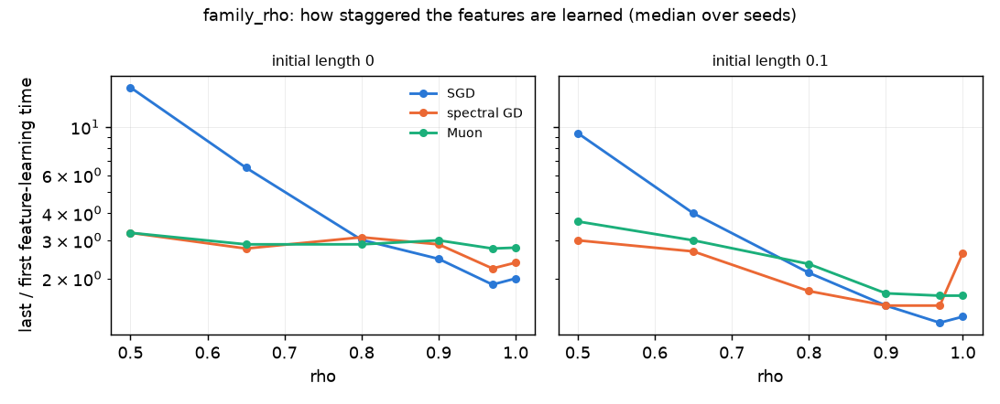

# TMS phase transitions under SGD, AdamW, spectral GD and Muon

Reproduction of Chen, Lau, Mendel, Wei, Murfet, *Dynamical versus Bayesian Phase Transitions in a
Toy Model of Superposition* (arXiv 2310.06301), r = 2, c = 6, extended to AdamW, spectral GD
(exact orthogonalised update, no momentum) and Muon (Newton–Schulz k = 5, Nesterov momentum 0.95 on W,
AdamW on the bias, as Muon is used in practice).

Every number below comes from the tables in this directory, regenerated in one pass by
`scripts/run_all.py` on the unified code (69 minutes for the five TMS stages on an RTX 4070
desktop; training and NUTS on the CPU, SGLD on the GPU). What changed against the first version
of this report is listed at the end.

## Summary

1. **The paper's results reproduce.** All 18 critical-point losses, the k-gon parameters, the prior
   constants and the 5→6 critical sample size (601) match to the printed digits (`tests/test_tms.py`).
   SGD trajectories plateau on the k-gon loss levels, every one of the 117 SGD transitions lowers
   the loss, and Table K.1 is reproduced in ordering and magnitude.
2. **Muon does not remove the plateau structure.** Under spectral GD and Muon, at every learning rate
   tried (1e-4 to 3e-3), trajectories sit on the same k-gon levels as under SGD; in the second half of
   training under 0.6 % of checkpoints are off a known critical point for every arm. Plateaus are
   shorter in epochs (median 40–220 against 360 for SGD).
3. **The Bayesian antecedent hypothesis is not contradicted by any optimizer.** Over 16 arms × 200
   seeds (983 transitions, 24 distinct types) and 4 arms × 400 posterior-initialised runs (71
   transitions, 2 further types), there are **0 transitions with loss down and λ down beyond error**
   and 0 uphill transitions. 24 of the 26 types have ΔL < 0, Δλ > 0 beyond the standard error and a
   free-energy crossing; the other two are within error of Δλ = 0 (one of them, 4⁺⁻→4, has
   Δλ = 1.9 ± 0.65 with the paper's own λ̂).
4. **Muon, spectral GD and AdamW make transitions SGD did not make here, and each one has an
   antecedent.** 12 of the 24 types occur only under non-SGD arms, for example 4⁻⁻→4⁻, 4⁺⁻⁻→4,
   4⁺⁺⁻⁻→4 and 4⁺⁺⁻→5. All 12 are loss-down, λ-up.
5. **One discrepancy with the paper on the Bayesian side.** Our NUTS posterior crosses 5→6 at
   n ≈ 300–400 when the posterior is exp(−n·L_n) with L_n the paper's loss, the convention in which
   the free-energy formula gives 601. See "Fig 2" below.

6. **What separates this from the deep linear network is the hierarchy, not the ReLU.** In a
   family that contains both, a hierarchy of feature importances makes a staircase under SGD that
   spectral GD and Muon remove at every activation slope; the k-gon transitions, which happen at
   equal importances, are shortened (13 times under Muon) but kept; and features that start dead
   stay dead under every optimizer. λ̂ climbs the staircase under SGD, rises once under the
   orthogonalised optimizers, and agrees between optimizers on shared states. See "A family
   between the TMS and a tied linear network".

Against the three ways Muon could have broken the hypothesis, fixed before the Muon runs:
(a) transitions with Δλ ≤ 0: none beyond error; (b) dwelling off critical points: no; (c) no plateau
structure: no.

## What was run

| | |
|---|---|
| Model, data | f(x) = ReLU(WᵀWx + b), W 2×6; x = μ·e_i; n = 1000, **one dataset per seed**, batch 20, 4500 epochs |
| Init | reference-notebook init: 4-gon of length 0.9 at a random rotation + N(0, 0.01²) on W, bias ~ N(0, 1) |
| SGD baseline | plain SGD, lr 0.005, loss = mean ‖x − f(x)‖² (the paper's L) |
| Arms | SGD; AdamW lr 1e-4…3e-3 (+ wd 0.01); spectral GD lr 1e-4…3e-3; Muon lr 1e-4…3e-3 (+ two SGD-bias ablations). `configs/tms/arms.json` |
| Muon and the bias | Muon only acts on W. The bias is under AdamW (lr 1e-3, β = (0.9, 0.999), no decay) at every Muon lr. Ablation: bias under plain SGD at lr 0.005. Spectral GD keeps the SGD bias, as the control that changes only the update on W |
| Seeds | 200 per arm; same init, dataset and minibatch order across arms |
| λ̂ on trajectories | paper settings: full-batch SGLD, ε = 0.001, γ = 1, 500 steps, 2 chains, every 30 epochs, first 30 seeds of the four headline arms (SGD, spectral 3e-4, Muon 3e-4, AdamW 3e-4) |
| λ̂ at critical points | paper protocol (Appendix K): n = 5000, γ = 0.1, 10 000 steps, 10 chains, their step sizes, escaped chains dropped |
| Posterior | NUTS (numpyro), prior N(0, 1) |
| Posterior-initialised runs | 400 NUTS samples at n = 100 as initial points, 5000 epochs, the four headline arms; λ̂ every 100 epochs for all 400 runs |

Two choices the paper leaves open were settled in the original exploration and were **not** rerun
in this pass; the statements are carried over as they were made then:

- **Momentum / loss scale of the baseline.** Four combinations were tried (momentum 0 or 0.9; loss
  divided by c or not). Plain SGD with the paper's loss gave transitions at epochs ~200–3800 in 13 of
  30 seeds (paper: 7 of 30 shown) and was kept. Momentum 0.9 with loss/6 was nearly identical.
- **One dataset per seed is needed.** With a single shared dataset 4⁺→5 never occurred. In the
  population loss the 4⁺-gon is locally stable (gradient flow from 4⁺ + noise of std 0.03 stays put;
  the Hessian near it has no negative eigenvalue). It becomes a saddle only through the finite-sample
  imbalance of the dataset, which is also why train and theory loss differ visibly in the paper's
  4⁺→5 figures.

A further point about the critical points themselves: for σ > 0 the gradient with respect to a
positive-bias zero column is (b/c)·Σ_i W_i, so 4^{σ+,φ−} is critical only if the columns sum to
zero. The paper's statement that a dead vertex's length is "subject only to l² < −b" holds for σ = 0.

## Figure-by-figure

| Paper | Here | Status |
|---|---|---|
| Table 1, A.1, C.2, Fig A.2 | `tests/test_tms.py` | match |
| Fig 1, B.1–B.7 | `figures/trajectory_seed*.png`, one column per optimizer | reproduced, Muon/AdamW added |
| Fig 3 | `figures/posterior_init_loss_vs_llc.png` | reproduced, Muon/AdamW added |
| Fig D.1 | `figures/transition_graph.png` | reproduced, Muon/AdamW added |
| Table K.1 | `table_k1.csv` | reproduced |
| Fig 2 | `figures/occupancy.png` | transition reproduced; location differs, see below |
| – | `figures/ensemble_loss*.png` | new: all 200 seeds per arm, and learning-rate sweeps |

### Dynamical transitions (Fig 1 / B)

`trajectory_seed002.png` is the paper's Fig 1 second half: 4⁺→5 with λ̂ going from about 4.5 to 6.8
under all four optimizers.

Across the 30 seeds with λ̂ estimates, every detected transition comes with a rise in on-trajectory
λ̂: 13/13 under SGD, 15/15 under spectral GD, 9/9 under Muon, 4/4 under AdamW
(`trajectory_llc_jumps.csv`; λ̂ before and after is the median over the plateau on each side; median
rise 5.0, 4.3, 3.9, 2.4; smallest 0.2 under AdamW, a 5→5⁺, and 1.4 otherwise).

These rises are not all the same kind of evidence. In 19 of the 41 the value before the transition
is negative, which means the SGLD chain left the plateau for lower loss and the number is not an
estimate of λ there. That is the case for every dead-vertex revival out of 4⁺⁻⁻ and 4⁺⁻⁻⁻ (7), for 10
of the 14 4⁺⁻→4, and for 2 of the 5 out of 4⁺⁺⁻. The 22 transitions with a positive value before (all eleven 4⁺→5, the three
4⁺⁺→5⁺, the three 4⁺⁺⁻→4⁺⁺, four 4⁺⁻→4 and the 5→5⁺) rise by a median of 2.8. Over all checkpoints,
47–55 % of the trajectory estimates under SGD, spectral GD and Muon fail the paper's chain-health
test (more than 5 % of draws below the starting loss) and 18 % are negative; under AdamW 29 % and 9 %.

Per arm, 200 seeds (`arms_summary.csv`, `transitions.csv`):

| arm | runs with a transition | transitions | antecedent | inconclusive | violation | types not seen under SGD | off-critical, 2nd half (%) | median plateau (epochs) | median plateau (path length) |
|---|---|---|---|---|---|---|---|---|---|
| SGD lr 0.005 | 108 | 117 | 69 | 48 | 0 | – | 0.42 | 360 | 7.6 |
| spectral lr 1e-4 | 127 | 141 | 100 | 41 | 0 | 4 | 0.45 | 220 | 4.8 |
| spectral lr 3e-4 | 128 | 134 | 91 | 43 | 0 | 6 | 0.02 | 80 | 2.3 |
| spectral lr 1e-3 | 70 | 72 | 55 | 17 | 0 | 4 | 0.06 | 90 | 6.0 |
| spectral lr 3e-3 | 37 | 38 | 38 | 0 | 0 | 3 | 0 | 135 | 27 |
| Muon lr 1e-4 | 120 | 124 | 83 | 41 | 0 | 4 | 0.007 | 120 | 1.3 |
| Muon lr 3e-4 | 67 | 70 | 49 | 21 | 0 | 4 | 0.01 | 50 | 0.89 |
| Muon lr 1e-3 | 15 | 15 | 15 | 0 | 0 | 1 | 0.02 | 80 | 4.2 |
| Muon lr 3e-3 | 15 | 15 | 15 | 0 | 0 | 1 | 0.01 | 130 | 21 |
| Muon lr 3e-4, SGD bias | 103 | 107 | 68 | 39 | 0 | 2 | 0 | 40 | 1.1 |
| Muon lr 1e-3, SGD bias | 26 | 27 | 26 | 1 | 0 | 1 | 0.10 | 120 | 7.8 |
| AdamW lr 1e-4 | 48 | 50 | 41 | 9 | 0 | 5 | 0.58 | 125 | 0.64 |
| AdamW lr 3e-4 | 32 | 32 | 28 | 4 | 0 | 1 | 0 | 80 | 0.86 |
| AdamW lr 1e-3 | 18 | 18 | 17 | 1 | 0 | 1 | 0 | 50 | 1.0 |
| AdamW lr 3e-3 | 5 | 5 | 5 | 0 | 0 | 0 | 0 | 60 | 3.1 |
| AdamW lr 1e-3, wd 0.01 | 18 | 18 | 17 | 1 | 0 | 1 | 0.002 | 95 | 2.3 |

"Inconclusive" is almost entirely the single type 4⁺⁻→4 (see below). Measured in distance travelled
in parameter space instead of epochs, plateaus under the orthogonalised optimizers are shorter than
SGD's at small learning rates and longer at large ones (0.9 to 27 against 7.6).

The fall in transition counts at high learning rate is partly a detection limit: a plateau must last
3 checkpoints (30 epochs), and fast arms pass through the early states sooner than that. End states
show where they go regardless: AdamW ends in a 5- or 5⁺-gon in 63–84 of 200 runs, Muon in 22–64,
spectral GD in 35–54, SGD in 18.

**Bias rule.** Putting the bias under AdamW instead of SGD changes rates, not the picture. At lr 3e-4
Muon makes fewer detected transitions (70 against 107). The drop is in the dead-vertex revivals
(4⁺⁻→4: 21 against 39; 4⁺⁻⁻→4⁻: 4 against 12; 4⁺⁺⁻→4⁺: 3 against 11) while 4⁺→5 is unchanged (18), and
the end states are nearly identical (4-gon 76 against 78, 5/5⁺-gon 30 against 26), so the revivals
still happen but the starting plateau is too short to register. At lr 1e-3 more runs end in a 5- or
5⁺-gon (53 against 30). The plateau levels, the kinds of transition and the verdicts are the same
under both bias rules.

Transition types pooled over arms (λ from theory for 5, 5⁺, 6, otherwise our Table K.1 estimate;
error = standard error over chains; n_cr from n·ΔL + Δλ·log n + Δc = 0):

| α → β | count | arms | ΔL | Δλ ± s.e. | n_cr | verdict | seen under SGD |
|---|---|---|---|---|---|---|---|
| 4⁺⁻ → 4 | 265 | 12 | −0.049 | 0.10 ± 0.39 | 16 | inconclusive | yes |
| 4⁺ → 5 | 245 | 16 | −0.035 | 0.97 ± 0.30 | 189 | antecedent | yes |
| 4⁺⁻⁻ → 4⁻ | 106 | 9 | −0.049 | 1.19 ± 0.33 | 129 | antecedent | yes |
| 4⁺⁺ → 5⁺ | 102 | 16 | −0.035 | 1.74 ± 0.23 | 331 | antecedent | yes |
| 4⁺⁺⁻ → 4⁺ | 73 | 8 | −0.049 | 0.88 ± 0.66 | 92 | antecedent | yes |
| 4⁺⁻⁻⁻ → 4⁻⁻ | 38 | 7 | −0.049 | 0.27 ± 0.21 | 29 | antecedent | yes |
| 4⁻⁻ → 4⁻ | 26 | 10 | −0.056 | 1.82 ± 0.26 | 179 | antecedent | no |
| 4⁺⁺⁻ → 4⁺⁺ | 24 | 12 | −0.056 | 1.61 ± 0.63 | 155 | antecedent | yes |
| 4⁺⁻ → 4⁺ | 23 | 10 | −0.056 | 1.40 ± 0.45 | 132 | antecedent | yes |
| 4⁺⁻⁻ → 4 | 19 | 6 | −0.104 | 2.71 ± 0.34 | 138 | antecedent | no |
| 5 → 5⁺ | 15 | 3 | −0.007 | 1.5 (theory) | 1594 | antecedent | no |
| 4⁺⁺⁻⁻ → 4 | 15 | 6 | −0.097 | 2.18 ± 0.42 | 117 | antecedent | no |
| 12 rarer types | 32 | | < 0 | > 0 except one | | 11 antecedent, 1 inconclusive | |

- 4⁺⁻→4 is the most common transition under every optimizer including SGD. Our estimates put the two
  ends at 4.63 ± 0.33 and 4.73 ± 0.21; the paper's Table K.1 has 3.39 and 5.30. So it is
  "inconclusive" from our critical-point estimates and "antecedent" from the paper's; nothing points
  to a violation. The on-trajectory estimates do not settle it, because most of the values before
  this transition are escaped chains (see above).
- 4⁺⁻⁻⁻→4⁻⁻ occurs at a very small n_cr (29), and the one 4⁺⁻⁻⁻⁻→4⁻⁻⁻ has Δλ = −0.04 ± 0.24; the
  paper also calls these inconclusive.
- The verdict of a transition type is a property of the loss landscape, not of the optimizer. What
  the optimizer changes is which types occur.

### Posterior-initialised runs (Fig 3)

All four arms end on the same levels: 159–165 runs at the 5-gon, 147–149 at the 4-gon, 38–40 at
the 6-gon, 20–24 at the 5⁺-gon, 19–21 at 4⁻. Lower-loss end states have higher on-trajectory λ̂
under every optimizer: 4.6 at the 4-gon, 6.8–6.9 at the 5-gon, 7.6–7.7 at the 5⁺-gon and 8.1–8.2 at
the 6-gon, the same to 0.1 across the four arms.

Transitions (`posterior_init_transitions.csv`): 5→5⁺ (6–10 per arm) and 4⁺→5 (4–10 per arm) make
up 61 of the 71; the rest are 4⁺⁻→4 (one per arm), 4→4⁺ (SGD, spectral GD), 4⁺⁻→4⁺ (Muon, spectral
GD), 4⁻→4 (Muon) and one 4→5 under spectral GD. No transition into the 6-gon was detected: every
run that ends in the 6-gon has it as its first plateau.

The mix of end states depends on the initial points, and those are one NUTS run. A second NUTS run
with the same settings gives a different mix (see "Changes" below), so the end-state counts say
that the four optimizers agree with each other on a given set of initial points, not what the
posterior shares at n = 100 are.

### Table K.1

Same ordering as the paper (rank correlation 0.99 over the 18 points). For 5, 5⁺, 6: 7.9, 10.5, 9.8
here; 7.7, 9.9, 9.0 in the paper; 7, 8.5, 8.5 in theory, so both sets of estimates sit above theory
for the three points where theory is known. Chains kept: 10 of 10 except 4⁺⁻⁻⁻⁻ (6), 4⁺⁺⁻⁻⁻⁻ (8),
4⁺⁺⁻ (7), 4⁺⁺ (8).

### Fig 2 (Bayesian 5→6 transition)

The transition exists and goes the right way: the 5-gon dominates at small n, the 6-gon at large n
(`figures/occupancy.png`, `occupancy.csv`, `occupancy_nll0.5.csv`; 3 datasets per n, 4 chains).
Where it happens depends on a factor of 2 in the likelihood:

| Posterior | 6-gon share passes the 5-gon share | Shares either side (5-gon / 6-gon) | Free-energy formula with that convention |
|---|---|---|---|
| exp(−n·L_n), L_n = mean ‖x − f‖² (the convention of the formula n·L + λ·log n) | between n = 300 and 400 | 0.64 / 0.31, then 0.21 / 0.76 | 601 |
| exp(−n·L_n/2), i.e. p(x\|w) ∝ exp(−½‖x − f‖²) as written in the paper's eq. (3) | between n = 700 and 800 | 0.53 / 0.42, then 0.20 / 0.77 | 1316 |

The paper reports 600–700 from MCMC and 601 from the formula. Our second row lands near their MCMC
range, our first row is the convention their formula is written in. So in both conventions our
sampled posterior switches to the 6-gon at roughly half the n the formula predicts, and the paper's
agreement between the two would be explained if their sampler used the eq. (3) likelihood while the
formula used L without the ½. I could not check their sampling code, so this is an inference from
our numbers, on 3 datasets per n. Chains stop mixing between basins at large n: from n = 800 on, 9
to 12 of the 12 chains per n sit in the 6-gon for their whole length, and the remaining 5- and
5⁺-gon share at n = 1000–1200 comes from the 1–3 chains that do not.

This does not touch the results on dynamical transitions: the sign of ΔL and Δλ for each transition
is unaffected, and only the quoted n_cr values would rescale.

## A family between the TMS and a tied linear network

In the deep linear networks of the other testbed the staircase of plateaus disappears under
spectral GD and Muon ([DLN report](../dln/REPORT.md)); here the plateaus stay. This section looks
for what separates the two, in one model with control parameters (`muon_llc.tms.family`):

    f(x) = leaky_slope(WᵀWx + b),   loss = mean_n Σ_j ρʲ (x_j − f_j(x))²

| parameter | paper's TMS | other end |
|---|---|---|
| slope of the activation for negative arguments | 0 (ReLU) | 1: a tied two-layer linear network |
| importance decay ρ (output j weighs ρʲ) | 1 (equal importances) | < 1: a hierarchy, as the singular values of the DLN target |
| initial point | 4-gon of length 0.9 + N(0, 0.01²) | length 0: W ~ N(0, 0.01²) or N(0, 0.02²) |
| initial bias | N(0, 1) | 0 |

Four scans, 24 seeds per grid cell, the same seeds in every cell, 1000 samples, batch 20. SGD at
lr 0.005; spectral GD and Muon at lr 3e-4 with the bias rules of the headline arms.

| scan | size | grid | epochs |
|---|---|---|---|
| `family_slope` | r = 4, c = 8 | slope 0, 0.05, 0.1, 0.25, 0.5, 0.75, 1; ρ = 0.5, small initial point, no bias | 8000 |
| `family_slope_paper` | r = 2, c = 6 | the same slopes; everything else as in the paper | 4500 |
| `family_scan` | r = 2, c = 6 | slope 0; ρ 1, 0.5 × initial length 0, 0.1, 0.3, 0.9 × bias spread 0, 0.1, 0.3, 1 | 4500 |
| `family_rho` | r = 2, c = 6 | slope 0; ρ 1, 0.97, 0.9, 0.8, 0.65, 0.5 × initial length 0, 0.1; no bias | 4500 |

Two readouts, both defined for every member of the family:

- **Learning time of a feature**: the epoch from which the loss on inputs carrying that feature
  stays below half of what it is when the model outputs zero. "Spread" is the last learning time
  of a run divided by its first, median over seeds (`summary.csv`).
- **State label** `<A>a<S>p`: A features represented (‖W_j‖² + b_j > 0.25, the test of the k-gon
  classifier) and S unrepresented features with a positive bias. For the paper's model
  k^{σ+,φ−} is (k − φ)a σp. A plateau is at least 3 checkpoints (30 epochs) with one label; a
  transition is "late" if the new plateau starts after epoch 300 (`states.csv`).

### Result: three kinds of slow structure, and the optimizers treat them differently

**1. A staircase made by the hierarchy of importances. Orthogonalised updates remove it.**

With ρ < 1 and a small initial point SGD learns the features one at a time, each taking about 1/ρ
times longer than the one before. Spectral GD and Muon learn them together. This holds at every
slope, so the ReLU plays no part in it.

Median epoch at which each feature is learned, `family_slope` (r = 4, c = 8, ρ = 0.5):

| optimizer, slope | f0 | f1 | f2 | f3 | f4 | f5 | f6 | f7 |
|---|---|---|---|---|---|---|---|---|
| SGD, 0 | 70 | 150 | 275 | 595 | 1145 | 3690 | 6555 | – |
| SGD, 1 | 70 | 160 | 330 | 805 | – | – | – | – |
| spectral GD, 0 | 40 | 40 | 40 | 50 | 70 | 120 | 160 | 275 |
| spectral GD, 1 | 40 | 40 | 40 | 50 | – | – | – | – |
| Muon, 0 | 40 | 40 | 40 | 50 | 90 | 110 | 130 | 190 |
| Muon, 1 | 40 | 40 | 40 | 50 | – | – | – | – |

| slope | spread SGD | spectral GD | Muon | runs with a late transition (of 24): SGD | spectral GD | Muon |
|---|---|---|---|---|---|---|
| 0 | 53.6 | 7.0 | 4.8 | 24 | 8 | 0 |
| 0.1 | 49.7 | 4.0 | 3.2 | 24 | 13 | 2 |
| 0.25 | 17.4 | 3.8 | 3.5 | 24 | 2 | 0 |
| 0.5 | 20.7 | 1.8 | 2.8 | 24 | 0 | 0 |
| 1 | 10.8 | 1.2 | 1.2 | 24 | 0 | 0 |

- The first four features (as many as W has rows) arrive within one or two checkpoints of each
  other under the orthogonalised optimizers. The features beyond the rank, which the ReLU model
  stores in superposition at small slope, still arrive in order (70 to 275 epochs), which is
  where the late transitions of spectral GD come from. W has r singular directions, so
  orthogonalising its update can equalise at most r modes.
- In the same time the orthogonalised optimizers store more: all 8 features at slope 0, against 6
  under SGD after 8000 epochs.
- Muon leaves 3 of 24 runs at slope 0 with a feature never learned (final loss up to 0.042, where
  spectral GD reaches 10⁻⁸ in all 24). I have not looked at whether that is the momentum or the
  AdamW bias.

The importance decay is the control parameter. `family_rho` (r = 2, c = 6, slope 0, small initial
point), figure `family_rho/spread_rho.png`:



| ρ | 1 | 0.97 | 0.9 | 0.8 | 0.65 | 0.5 |
|---|---|---|---|---|---|---|
| spread, SGD | 2.0 | 1.9 | 2.5 | 3.0 | 6.5 | 15.2 |
| spread, spectral GD | 2.4 | 2.2 | 2.9 | 3.1 | 2.8 | 3.3 |
| spread, Muon | 2.8 | 2.8 | 3.0 | 2.9 | 2.9 | 3.3 |
| runs with a late transition, SGD | 2 | 2 | 1 | 7 | 18 | 23 |
| spectral GD | 6 | 4 | 4 | 0 | 0 | 0 |
| Muon | 1 | 1 | 0 | 0 | 0 | 0 |

At ρ = 1 the three optimizers are alike (spread 2 to 3). As ρ falls the SGD staircase opens up and
the other two do not move. Over the whole of `family_scan` at ρ = 0.5, SGD has a late transition
in 182 of 384 runs, spectral GD in 12 and Muon in none.

**2. Rearrangements at equal importances. Orthogonalised updates shorten them but keep them.**

These are the paper's transitions. From a 4-gon with zero bias (`family_scan`, ρ = 1, bias
spread 0) the state is 4a2p, the paper's 4⁺⁺, and some runs go to 5a1p, the 5⁺-gon:

| initial length 0.9 | SGD | spectral GD | Muon |
|---|---|---|---|
| median dwell before the transition (epochs) | 1240 | 510 | 95 |
| runs ending in 5a1p (of 24) | 7 | 12 | 8 |

The plateau is 2.4 times shorter under spectral GD and 13 times shorter under Muon, against a
staircase that collapses to the detection floor in kind 1. Spectral GD makes the transition more
often than SGD. Over `family_scan` at ρ = 1, SGD has a late transition in 51 of 384 runs and
spectral GD in 53.

The linear model with equal importances behaves the same way (`family_slope_paper`, slope 1): 23
of 24 runs make late transitions under SGD and under spectral GD, 8 under Muon. So this kind of
plateau does not need the ReLU either; it needs the absence of a hierarchy. My reading, which I
have not tested, is that the direction of escape is set by the finite-sample imbalance of the
dataset, a signal below the minibatch noise; normalising the update does not help when it is
dominated by noise, and Muon's momentum averages the noise.

Between slopes 0.25 and 0.75 the 4-gon start has at most one late transition in 24 runs under any
optimizer, and every run ends in the same state (4a2p).

**3. Features that start dead. No optimizer revives them.**

With a small initial point, a feature whose initial bias is negative has a ReLU that never opens,
so it gets no gradient. Any bias spread from 0.1 up leaves about half the features dead, and the
distribution of end states is set by the initial point: at ρ = 1 and bias spread 1 it is 3, 2, 4
and 1 live features in 7, 6, 5 and 4 runs under SGD, spectral GD and Muon alike. These are frozen
states, not plateaus: nothing leaves them. (At bias spread 0.1 spectral GD revives a few: 13 runs
end with 3 live features against 6 under SGD.)

The paper's initial point combines kinds 2 and 3 at ρ = 1, where kind 1 does not exist. The DLN is
kind 1 alone.

### λ̂ along the trajectories

Paper settings (full-batch SGLD, ε = 0.001, γ = 1, 500 steps, nβ = n / log n), 4 chains, 8 seeds
per cell, 36 to 41 checkpoints evenly spaced in log time (`llc.csv`, `llc_by_state.csv`,
`llc_<optimizer>.png`). "Escaped" is the paper's health test: more than 5 % of draws below the
starting loss.

Median λ̂ by number of features learned, `family_slope`:

| features learned | slope 1: SGD | spectral GD | Muon | slope 0: SGD | spectral GD | Muon |
|---|---|---|---|---|---|---|
| 0 | 0.4 (escaped) | 0.6 (escaped) | 0.8 (escaped) | −4.1 (escaped) | −3.8 (escaped) | −3.7 (escaped) |
| 1 | 4.7 | – | – | 0.2 (escaped) | – | – |
| 2 | 7.2 | – | – | 2.4 (57 % escaped) | – | – |
| 3 | 8.9 | 5.2 | 5.2 | 3.4 | −0.3 (escaped) | 0.2 (escaped) |
| 4 | 9.9 | 9.8 | 9.9 | 4.0 | 2.9 | 3.6 |
| 5 | | | | 4.6 | 4.4 | 4.4 |
| 6 | | | | 4.9 | 4.8 | 4.3 |
| 8 | | | | – | 5.3 | 5.3 |

Entries with "–" have at most 2 estimates; the 3-feature entries of spectral GD and Muon have 6
or 7.

- **Under SGD λ̂ climbs a staircase with the features**, with shrinking steps (slope 1: 4.3, 2.5,
  1.7, 1.0), as in the DLN.
- **Under spectral GD and Muon it rises once**, to the same end value (slope 1: 10.0, 10.1, 9.9).
- **λ̂ is a property of the state, not of the optimizer**, where the state is one the chain can
  stay in. From the 4-gon start at ρ = 1 the three optimizers give 5.0, 5.0, 5.0 with four
  features (4⁺⁺) and 7.3, 7.5, 7.6 with five (5⁺). Table K.1, with chains twenty times longer at
  n = 5000, has 6.8 and 10.5 for these two states, so the trajectory settings read low and only
  the comparison between optimizers carries weight.
- **The states the orthogonalised optimizers pass through are not the saddles SGD rests on.** With
  three features learned at slope 1, λ̂ is 8.9 under SGD and 5.2 under the other two: all four
  features are partly grown there.
- **More features is not higher λ̂.** At the end of training λ̂ falls from 10 at slope 1 (4
  features) to about 5.3 at slope 0 (8 features).
- **Early states cannot be estimated.** With no feature learned every chain escapes; at slope 0 so
  do all chains with one feature and 57 % with two.
- **Frozen dead-feature states are not states of the posterior.** At the last checkpoint of
  `family_scan`, 55 to 75 % of the estimates are escaped chains wherever the bias spread is 0.1 or
  more, against 0 to 3 % at bias spread 0, for every optimizer. The sampler's noise opens a ReLU
  that gradient descent cannot.

So the expectation from singular learning theory, that the trajectory moves through states of
rising λ, is met where there are states: on the SGD staircase and across the k-gon transitions.
Under the orthogonalised optimizers the staircase is not traversed faster, it is not visited, and
only the end value is shared. The dead-feature states are a third case: dynamically stable and
invisible to the posterior.

## Limits

- λ̂ is noisy for the degenerate 4-gons (chain std 0.4–1.5). Verdicts for those rest on the sign of
  a point estimate with a standard error from 6–10 chains; systematic SGLD bias is not included.
- On-trajectory λ̂ at the paper's settings is an escaped chain at roughly half of the checkpoints,
  so "λ̂ rises at every transition" is firm for the 22 transitions with a healthy value before and a
  statement about the chain leaving the plateau for the other 19.
- Trajectory λ̂ was estimated for 30 seeds of the four headline arms, not for every arm.
- One model size (r = 2, c = 6), constant learning rates, no schedule. Muon's weight decay was 0.
- Checkpoints are every 10 epochs, so sub-30-epoch plateaus under fast arms are not counted.
- The double-transition concavity check of Appendix C.4 was not done; runs with two transitions are
  rare (at most 14 of 200 per arm).
- Fig 2 uses 3 datasets per n and 4 chains, against 10 and 6 in the paper; no t-SNE diagnostics.
- The family scans use 24 seeds, one learning rate per optimizer and a 30-epoch floor on plateau
  length. Their λ̂ uses 500-step chains with no reference values away from the k-gons, so the
  staircase values are relative. One Muon cell (`family_slope`, slope 0.75) has its transition
  count inflated by a run that flickers across the label threshold. The scans are not in
  `scripts/run_all.py`.
- Three settings of this pass were reconstructed, because the first version did not record them:
  1500 NUTS samples per chain for Fig 2, λ̂ every 100 epochs on all 400 posterior-initialised runs,
  and the definition of the rise in `trajectory_llc_jumps.csv` (median over each plateau). The jump
  table covers the four headline arms.
- Muon's Newton–Schulz runs in float32, and its trajectories differ between CPU and GPU (4e-3 in
  the weights after 1500 steps). All training here ran on the CPU. Counts over seeds are comparable
  across devices; individual Muon seeds are not.

## Changes from the first version of this report

The first version was produced on the TMS branch before the two projects were joined. The rerun
used the same seeds and settings.

- **Table K.1 is identical** to nine digits. It now goes through the sampler shared with the DLN
  testbed, on the GPU.
- **SGD and AdamW arms are identical** in every count. **Spectral GD and Muon arms moved by at most
  two transitions per arm** (for example spectral lr 3e-4: 134 against 132), which changes the total
  from 980 to 983 and some "types not seen under SGD" counts by one or two. No verdict changed.
- **The posterior-initialised runs start from different points.** The 400 initial points are drawn
  by NUTS, which did not reproduce the earlier draw (same seed and settings, different JAX build).
  By shape, the new points are 116 5-gons and 105 4-gons where the old ones were 152 and 92.
  End-state counts moved accordingly (about 160 runs at the 5-gon against about 200, 148 at the
  4-gon against 117, 39 at the 6-gon against 29) and there are 71 transitions against 66.
- **The single 5→6 transition under spectral GD did not recur.** The first version reported one
  among the posterior-initialised runs and called it the transition the paper predicts but never
  saw under SGD. No arm shows it in this run, so that sentence is withdrawn; one occurrence in 1600
  runs that does not survive a redraw of the initial points is not a finding.
- **New in this version:** the breakdown of on-trajectory rises into healthy and escaped chains,
  and the share of trajectory estimates failing the chain-health test. The first version stated the
  rises without it.
- The first version said the SGD transitions "are the ones in the paper's list". I did not recheck
  that against the paper in this pass, so the sentence is not repeated.

## Reproduce

```bash
uv sync --extra dev --extra mcmc
```

```bash
uv run python scripts/run_all.py --stages tms-arms tms-llc tms-k1 tms-posterior tms-analysis
```

The stages, with the time each took here:

| Stage | Module (`muon_llc.tms.experiments.`) | Device | Minutes |
|---|---|---|---|
| `tms-arms` | `arms` (16 arms × 200 seeds, 8 processes) | CPU | 25 |
| `tms-llc` | `estimate` on the four headline arms | GPU | 2.4 |
| `tms-k1` | `critical_llc` | GPU | 2.0 |
| `tms-posterior` | `posterior inits`, `arms --init`, `estimate`, `posterior occupancy` (both likelihoods) | CPU (NUTS, training), GPU (λ̂) | 33 |
| `tms-analysis` | `bah` (twice), `figures` | CPU | 5.9 |

The family scans are run by hand, per config (`family_slope`, `family_slope_paper`, `family_scan`,
`family_rho`) and per optimizer (`sgd`, `spectral`, `muon`):

```bash
uv run python -m muon_llc.tms.experiments.family train --config configs/tms/family_rho.yaml --opt sgd
```

```bash
uv run python -m muon_llc.tms.experiments.family analyse --config configs/tms/family_rho.yaml
```

```bash
uv run python -m muon_llc.tms.experiments.family llc --config configs/tms/family_slope.yaml --device cuda
```

Training took 10 to 38 minutes per optimizer on the CPU with three to nine running side by side
(`family_scan` the longest), λ̂ under a minute per optimizer for `family_slope` on the GPU. Outputs
go to `runs/tms/<config>/`; the tables and figures were copied from there to
`results/tms/<config>/`.

The exact command of every step is in `runs/logs/<stage>.log` after a run, and
`uv run python scripts/run_all.py --dry-run` prints them without running anything.
`uv run python -m muon_llc.tms.experiments.smoke` is a one-minute end-to-end check.
